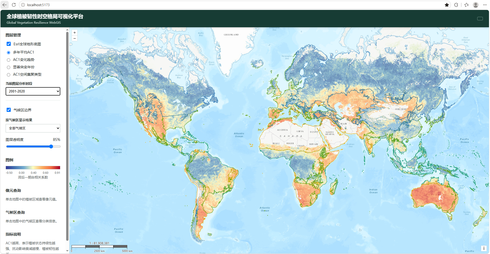
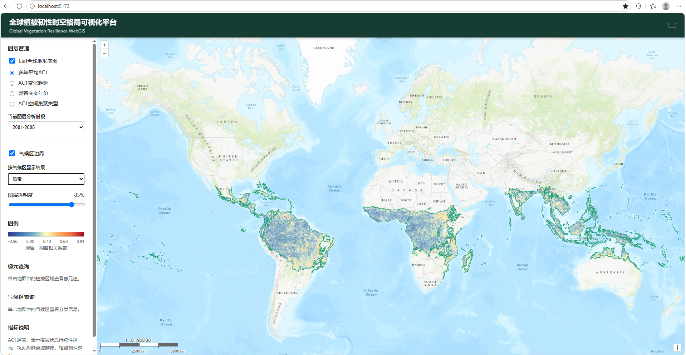
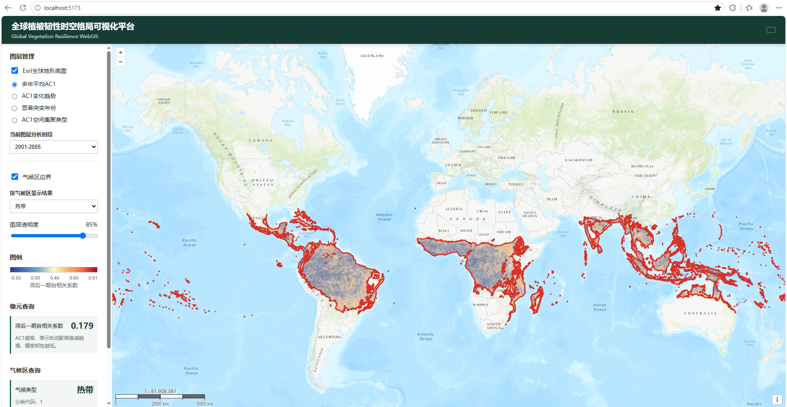
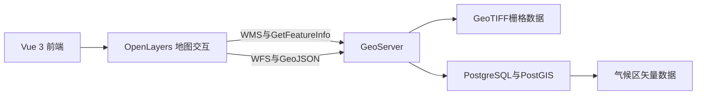

# 全球植被韧性时空格局可视化平台

基于 Vue 3、OpenLayers、GeoServer、PostgreSQL 和 PostGIS 构建的 WebGIS 原型，用于展示 2001—2020 年全球植被韧性的空间格局、变化趋势、显著突变年份和空间集聚类型。

本项目将硕士研究中的栅格分析结果与气候区矢量数据接入 WebGIS，提供图层切换、时段切换、像元查询、气候区筛选和空间裁剪等功能。当前版本用于本地展示、项目作品集和研究成果可视化，尚未完成公网生产部署。

## 项目预览

### 总体界面



### 多时段AC1切换


### 气候区筛选与栅格裁剪



### 像元查询



### 演示视频

[查看本地演示视频](docs/images/vegetation-resilience-webgis-demo.mp4)

## 技术栈

| 类型 | 技术 |
|---|---|
| 前端框架 | Vue 3、Vite |
| 地图引擎 | OpenLayers 10 |
| 地图服务 | GeoServer |
| 空间数据库 | PostgreSQL 18、PostGIS 3.6.2 |
| 栅格服务 | OGC WMS、GetFeatureInfo |
| 矢量服务 | OGC WFS、GeoJSON |
| 底图 | Esri World Topographic Map |
| 数据坐标系 | EPSG:4326 |
| 地图视图坐标系 | EPSG:3857 |

## 系统结构



前端负责地图展示和交互。GeoServer发布研究结果栅格和气候区矢量服务。PostGIS保存气候区矢量数据。Vite开发代理将前端的 `/geoserver` 请求转发到本地GeoServer。

## 已实现功能

### 栅格数据展示

- 多年平均AC1、AC1变化趋势、显著突变年份和AC1空间集聚类型切换
- 2001—2020年及四个五年阶段的平均AC1切换
- 连续型图例和分类图例动态更新
- 结果图层透明度调节
- WMS GetFeatureInfo像元查询
- 像元值格式化和结果解释
- 世界地图横向重复显示限制

### 矢量数据交互

- GeoServer WFS气候区边界加载
- 气候区边界显示和隐藏
- 五类气候区筛选
- 气候区属性点击查询
- 选中气候区高亮
- 按气候区边界裁剪栅格可见范围

### 工程功能

- Vue 3响应式状态管理
- OpenLayers栅格与矢量图层管理
- GeoServer WMS和WFS统一接入
- PostGIS空间数据存储
- Vite开发代理
- Vite生产环境构建

## 图层与分析时段

| 图层 | GeoServer图层名 | 分析时段 |
|---|---|---|
| 多年平均AC1 | `resilience:mean_kndvi_ac1` | 2001—2020年 |
| 第一阶段平均AC1 | `resilience:mean_ac1_2001_2005` | 2001—2005年 |
| 第二阶段平均AC1 | `resilience:mean_ac1_2006_2010` | 2006—2010年 |
| 第三阶段平均AC1 | `resilience:mean_ac1_2011_2015` | 2011—2015年 |
| 第四阶段平均AC1 | `resilience:mean_ac1_2016_2020` | 2016—2020年 |
| AC1变化趋势 | `resilience:ac1_trend` | 2001—2020年 |
| 显著突变年份 | `resilience:mutation_year` | 2001—2020年 |
| AC1空间集聚类型 | `resilience:lisa_cluster` | 2001—2020年 |
| 气候区 | `resilience:climate_zones` | 气候基准期数据 |

趋势、突变和当前空间集聚图层固定使用完整研究期。前端不会把五年时段错误地标注到这些图层上。完整数据和服务记录见 [data_layers.md](data_layers.md)。

## 项目目录

```text
vegetation-resilience-webgis/
├── docs/
│   └── images/
│       ├── overview.png
│       ├── period-comparison.png
│       ├── climate-filter.png
│       ├── pixel-query.png
│       └── vegetation-resilience-webgis-demo.mp4
├── public/
├── src/
│   ├── App.vue
│   ├── main.js
│   └── style.css
├── data_layers.md
├── index.html
├── package.json
├── vite.config.js
└── README.md
```

原始GeoTIFF、Shapefile、GeoServer数据目录和PostgreSQL数据库文件不包含在代码仓库中。

## 本地运行条件

运行前需要准备：

1. Node.js和npm。
2. PostgreSQL与PostGIS。
3. GeoServer。
4. 已发布的WMS与WFS图层。

完整页面依赖以下三个服务：

- PostgreSQL服务保存气候区矢量数据。
- GeoServer发布WMS和WFS。
- Vite运行前端并提供开发代理。

## 本地启动步骤

### 1. 启动PostgreSQL

在Windows服务管理器中确认 PostgreSQL 18 服务正在运行。pgAdmin只用于数据库管理，不需要始终保持打开。

### 2. 启动GeoServer

运行：

```powershell
& "D:\webgis\geoserver\bin\startup.bat"
```

确认以下地址可访问：

```text
http://localhost:8088/geoserver
```

### 3. 安装前端依赖

首次运行时执行：

```powershell
Set-Location D:\webgis\projects\vegetation-resilience-webgis
npm.cmd install
```

### 4. 启动前端

```powershell
npm.cmd run dev
```

浏览器访问：

```text
http://localhost:5173
```

## 生产构建

执行：

```powershell
npm.cmd run build
```

构建结果生成在 `dist` 目录。当前版本已通过Vite生产构建。

需要注意，开发环境中的 `/geoserver` 代理由Vite提供。将 `dist` 部署到静态托管平台后，还需要配置反向代理、同源访问或GeoServer跨域策略。当前项目不能仅上传到GitHub Pages后直接连接本地GeoServer。

## 数据解释

AC1表示植被状态的持续性。AC1越高，说明扰动影响衰减越慢，在本研究的指标定义下对应相对较低的植被韧性。

气候区筛选通过矢量边界裁剪当前栅格的可见范围。它只改变地图显示，不会重新计算所选气候区内的AC1均值、趋势、突变比例或集聚比例。

## 方法限制

1. 当前LISA分类尚未完成规范的局部Moran随机置换显著性检验。类别0只能解释为未划分类别，不能解释为统计不显著。
2. 趋势图的颜色显示范围仍需与原始栅格有效像元统计结果核对。
3. 不同历史分析代码中存在气候类型编码不一致，需要依据原始重分类规则统一审计。
4. 趋势方向不等同于趋势达到统计显著，也不能直接支持因果结论。
5. Pettitt结果需要结合显著性栅格解释，并考虑逐像元多重检验产生的假阳性风险。
6. 当前系统用于研究结果可视化，不替代论文中的统计分析、不确定性评估和稳健性检验。

## 工程限制

- 当前依赖本地PostgreSQL和GeoServer。
- 尚未完成公网生产部署。
- 尚未建立自动化测试和统一启动脚本。
- WFS当前一次性加载全球气候区几何，后续可通过几何简化和空间范围请求优化。
- 移动端布局尚未完成系统测试。

## 功能验证

以下功能已经完成手工验证：

- 四类WMS结果图层切换
- 多年平均AC1时段切换
- 图层分析时段正确显示
- 图层透明度控制
- 动态图例
- WMS像元查询
- WFS气候区加载
- 气候区开关、筛选、查询与高亮
- 气候区栅格显示裁剪
- Vite生产构建

最后验证日期为2026年10月7日。

## 后续工作

- 规范计算局部Moran统计量及置换显著性
- 核对趋势栅格值域和气候区编码
- 增加气候区统计汇总和图表联动
- 优化WFS几何加载性能
- 增加自动化测试
- 配置GeoServer、PostGIS和前端的生产部署环境

## 使用说明

本项目用于个人研究成果展示和WebGIS开发能力说明。数据解释、论文引用和进一步使用应以经过核查的原始数据、分析代码和论文方法为准。
